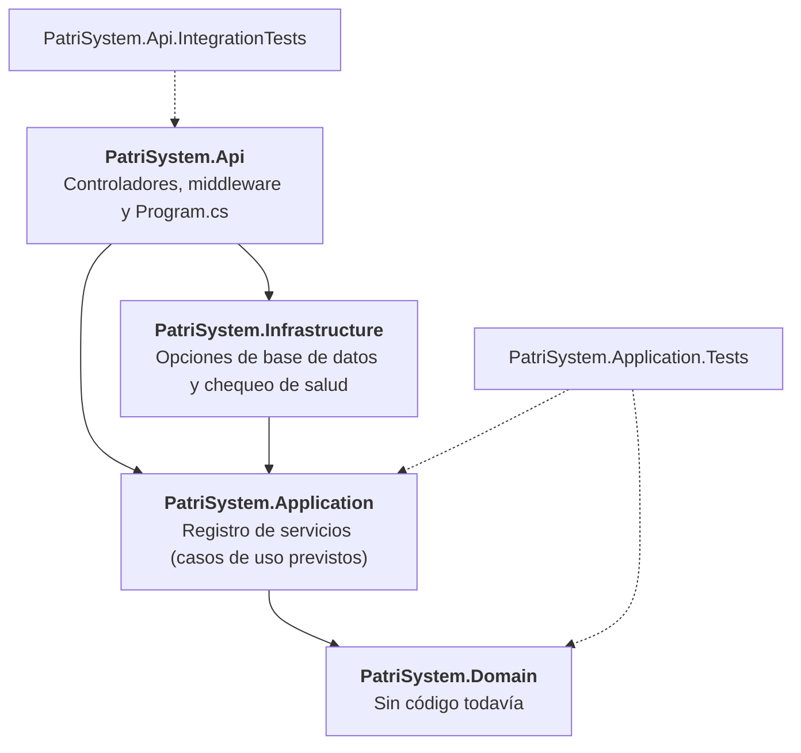
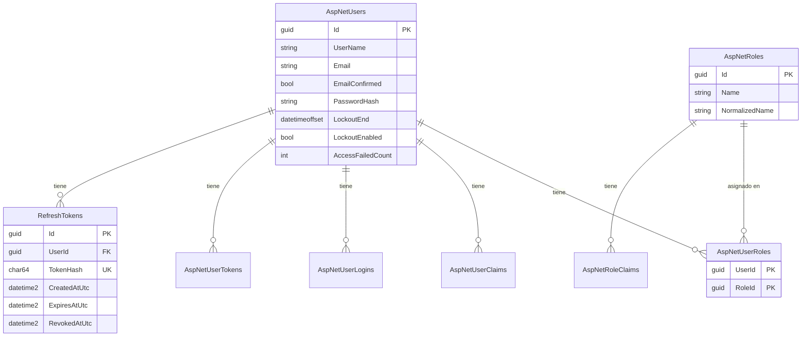

# Arquitectura

PatriSystem sigue Clean Architecture: las dependencias apuntan siempre hacia adentro. La decisión y sus costos están en el [ADR-001](adr/0001-clean-architecture.md).

## Capas

La flecha significa "depende de".

Las flechas punteadas son los proyectos de pruebas.

## Qué hay en cada capa hoy y qué se prevé

| Capa | Hoy | Previsto |
|---|---|---|
| Domain | Nada | Entidades y reglas puras |
| Application | `DependencyInjection` | Casos de uso, interfaces y validadores |
| Infrastructure | `DatabaseOptions`, `DatabaseHealthCheck`, `ApplicationDbContext`, Identity (`ApplicationUser`, `ApplicationRole`), `RefreshToken` y siembra de roles | JWT y correo |
| Api | Controlador de ejemplo (`ping`), middleware de correlación y de errores, documentación OpenAPI | Controladores de cada caso de uso |

## Modelo de datos

Tablas que crea la migración `InitialIdentity`. Las siete tablas de ASP.NET Core Identity llevan sus nombres por defecto y clave `Guid`; `RefreshTokens` es propia. Decisiones en el [ADR-005](adr/0005-identity-y-persistencia.md).

Notas:

- `RefreshTokens.TokenHash` guarda solo el hash del token, nunca el valor en claro.
- Al borrar un usuario se borran en cascada sus tokens y sus filas de roles, claims, logins y tokens de Identity.
- `AspNetUsers` muestra solo las columnas relevantes; la tabla real tiene más (correo normalizado, teléfono, sello de seguridad y otras).
- Los roles `Admin` y `Cajero` se crean al arrancar la API (`Identity:SeedOnStartup`).

## Reglas que se comprueban automáticamente

Las pruebas de `tests/PatriSystem.Application.Tests/Architecture/` fallan si se rompe alguna:

- Domain no referencia proyectos, paquetes ni frameworks.
- Application solo referencia Domain, y solo usa los paquetes de una lista explícita.
- Domain y Application no usan EF Core, ASP.NET, Identity ni JWT.
- Las capas internas no usan las externas.

## Decisiones asociadas

- **Domain no tiene clase `DependencyInjection`:** no registra nada y debe quedar sin paquetes. Es una excepción consciente al criterio "cada capa" del ticket FND-02.
- **Infrastructure se referencia desde Api** solo para registrar la inyección de dependencias.
- **Estructura:** el código de producción vive en `src/` y las pruebas en `tests/`.